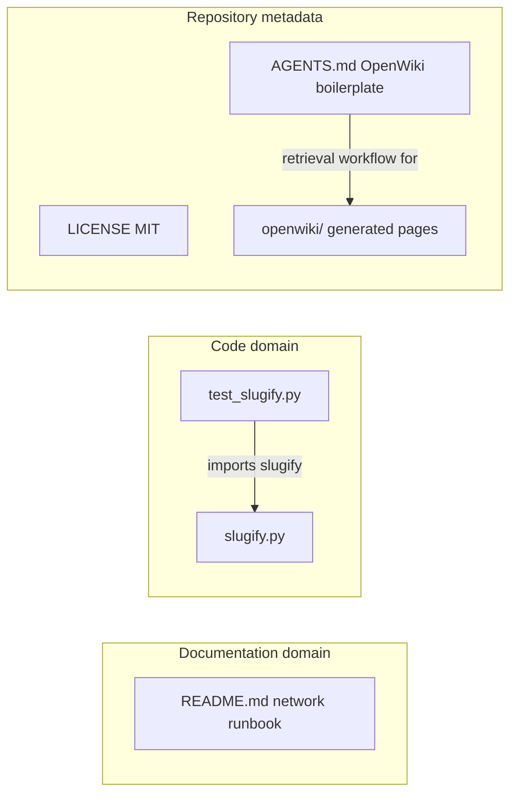

# Repository Layout

This repository is small, flat, and documentation-first. Its root holds exactly
five authored files — `README.md`, `slugify.py`, `test_slugify.py`, `LICENSE`,
and `AGENTS.md` — plus a generated `openwiki/` directory and `.git` metadata.
There are no other top-level entries: no dotfiles, no source or configuration
subdirectories, and no package/build/CI files of any kind.

Two completely unrelated concerns live side by side:

1. **The network runbook** — `README.md` is the repository's main deliverable,
   a self-contained guide for routing FRITZ!Box 6591 Cable IPTV streams through
   an OPNsense firewall.
2. **The slug utility** — `slugify.py` is a self-contained text-helper module
   with its pytest suite in `test_slugify.py`.

There are **no internal dependencies between the two domains**. The runbook
never mentions the slug helper, and the helper code never references the
network guide; they share no files, imports, or build steps. The only internal
dependency edge anywhere in the repository is `test_slugify.py` importing
`slugify.py`.



*The only internal import edge is `test_slugify.py` → `slugify.py`; `AGENTS.md`
describes how agents should retrieve and treat the generated `openwiki/` pages;
`README.md` and `LICENSE` are isolated.*

## Top-level map

| Path | Kind | Role |
| --- | --- | --- |
| `README.md` | Documentation (primary deliverable) | Complete runbook: enabling FRITZ!Box 6591 Cable DVB-C IPTV (RTP) streams to traverse an OPNsense firewall into the internal LAN. The repository's sole source of truth for the networking topic. |
| `slugify.py` | Code | Standalone single-function helper `slugify(text)` that converts text to URL-friendly slugs. Imports nothing beyond the standard library (`re`, `unicodedata`). |
| `test_slugify.py` | Code (tests) | pytest suite for `slugify()` — the only automated check in the repository. |
| `LICENSE` | Metadata | MIT license, Copyright (c) 2023 ulbi, covering the whole repository. |
| `AGENTS.md` | Metadata (boilerplate) | OpenWiki agent guidance, wrapped in `<!-- OPENWIKI:START -->` / `<!-- OPENWIKI:END -->` markers. |
| `openwiki/` | Generated metadata | Output of the OpenWiki update run: generated wiki pages plus run-state records. Not hand-maintained source. |
| `.git/` | Version control | Plain git checkout of branch `main` tracking a single GitHub origin (`github.com/ulbi/fritzbox-dvbc-opnsense`). No submodules. |

## README.md — the primary deliverable

`README.md` is a runbook, not a project overview. Its title — *Accessing
FRITZ!Box 6591 Cable IPTV Streams Through an OPNsense Firewall: Complete
Guide* — is the deliverable itself; the file contains no install instructions,
no repository description, and no mention of `slugify.py`. It is organized as
Background, Challenge, Objectives, Steps (Prerequisites, OPNsense
Configuration, FRITZ!Box Configuration, Testing and Monitoring), and Final
Notes, with concrete values such as rule interfaces, port 554, the UDP source
port range 5000–5010, and the 192.168.180.0 ↔ 192.168.178.0 one-to-one NAT
mapping.

Because it is prose, editing it needs no build step — change the file and the
content is shipped. The wiki mirrors this guide in
[IPTV Streams Through OPNsense Firewall](../networking/iptv-through-opnsense.md).

## slugify.py — a self-contained utility

`slugify.py` is a 51-line module exposing exactly one public function,
`slugify(text: str) -> str`, and importing only the standard-library modules
`re` and `unicodedata`. There are no project-internal imports, no third-party
imports, and no module-level state, which makes the helper safe to copy or
inline into another project (under the MIT terms of `LICENSE`).

Its pipeline runs in a fixed order: explicit German umlaut/ß transliteration
(`ä→ae`, `ö→oe`, `ü→ue`, `ß→ss`, plus uppercase variants), NFKD Unicode
normalization with an ASCII-ignore encode/decode, lowercasing, collapsing of
every non-`[a-z0-9]` run into a single hyphen via
`re.sub(r"[^a-z0-9]+", "-", text)`, and finally stripping leading/trailing
hyphens. Empty input returns an empty string. Full contract details are in
[Slugify Behavior](../slugify/behavior.md).

## test_slugify.py — the only automated check

`test_slugify.py` holds a single `TestSlugify` class with twelve test methods
grouped by concern: basic ASCII conversion, umlaut transliteration, sharp-s
(ß) transliteration, mixed-case handling, special-character removal, number
preservation, whitespace/hyphen collapsing, empty and special-characters-only
input, Unicode normalization, hyphen trimming, and idempotency of
already-slugified strings.

Run it from the repository root:

```bash
pytest test_slugify.py      # add -v for verbose output
```

The import `from slugify import slugify` resolves without any installation
step because both files sit in the same directory. The file also ends with an
`if __name__ == "__main__":` guard calling `pytest.main([__file__, "-v"])`,
so it can be executed directly. Since this suite is the repository's only
automated verification, any change to the transliteration map or the pipeline
in `slugify.py` should be paired with a matching test update here. Mapping of
behaviors to assertions is in [Slugify Tests](../slugify/testing.md).

## Metadata files

- **`LICENSE`** — the standard MIT license text, Copyright (c) 2023 ulbi. It
  is the single license statement for everything in the repository, including
  the `slugify.py` helper.
- **`AGENTS.md`** — entirely OpenWiki boilerplate: the whole file sits between
  the `OPENWIKI:START`/`OPENWIKI:END` markers. It tells agents **not** to
  enumerate, preload, or search wikis at task start; to use `openwiki_search`
  for just-in-time context and `openwiki_read` for complete sections when
  retrieval is warranted (asking which listed workspace to use if search
  returns `workspace_required`); to use `openwiki_list_workspaces` /
  `openwiki_list_wikis` when workspace membership itself matters; to fall back
  to reading `openwiki/quickstart.md` only when the retrieval tools are
  unavailable; that source code and tests are authoritative; and that
  generated pages should be refreshed through the maintenance process rather
  than hand-edited. Keep the marker block intact when editing this file.
- **`openwiki/`** — generated output of the OpenWiki update run (generated
  wiki pages plus run-state records), not hand-maintained source. Per
  `AGENTS.md`, treat it as optional just-in-time context and refresh it
  through the documented maintenance process rather than editing it by hand;
  nothing here needs manual upkeep.

## What is not here

The repository has **no build, CI, or dependency infrastructure**:

- **No package manifest** — no `setup.py`, `setup.cfg`, `pyproject.toml`,
  `requirements*.txt`, `Pipfile`, or lockfile. The root-directory layout is
  the entire packaging story: code is run from the checkout, never installed.
- **No CI configuration** — no `.github/` directory, no workflow files, no
  `.gitlab-ci.yml` or equivalent. Nothing runs the tests automatically.
- **No build script or task runner** — no `Makefile`, `Dockerfile`, `tox.ini`,
  or `noxfile.py`. There is nothing to build; `README.md` is shipped as-is and
  `slugify.py` is imported in place.
- **No pinned dev dependencies** — the only tool the repository requires is
  `pytest`, imported directly by `test_slugify.py` and not pinned anywhere
  (install it ad hoc, e.g. `pip install pytest`).
- **No lint/format/type-check configuration** and no dotfiles at all — no
  `.gitignore`, `.editorconfig`, or pre-commit hooks.
- **No submodules or worktrees** — a single flat git checkout of `main`.

## Calibrating scope before editing

- Changing the runbook means editing `README.md` prose only; see
  [IPTV Streams Through OPNsense Firewall](../networking/iptv-through-opnsense.md).
- Changing slug behavior means editing `slugify.py` **and** the corresponding
  assertions in `test_slugify.py`, then running `pytest test_slugify.py`.
- There is no registry, manifest, or wiring to update when adding a file —
  but also nothing to run it: any new automation (linting, CI) would have to
  be introduced from scratch.
- Treat source and tests as authoritative and generated `openwiki/` pages as
  refreshable context, per `AGENTS.md`. For a fast orientation entry point,
  see [Quickstart](../quickstart.md).
