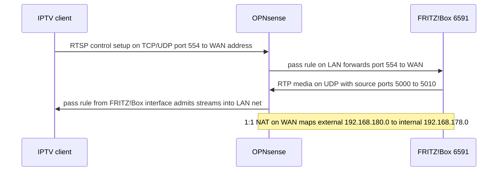

# IPTV Streams Through OPNsense Firewall

This page mirrors the repository's primary reference,
[README.md](../../README.md), as a runnable runbook. The scenario: a
**FRITZ!Box 6591 Cable** modem with **DVB-C** functionality provides up to
**4 IPTV streams** that any compatible IPTV client can access, and an
**OPNsense firewall** sits between the FRITZ!Box and the internal network,
segregating segments for IoT devices and other equipment while managing
inbound and outbound access rules.

The specific problem this guide solves: there was no documentation for how to
access the FRITZ!Box 6591 Cable IPTV streams through the OPNsense firewall,
especially the **RTP (Real-time Transport Protocol)** media streams. The
runbook's two objectives are to (1) make the RTP streams from the FRITZ!Box
flow to the end devices through the OPNsense firewall and (2) document the
procedure for exactly this scenario.

## How the traffic flows

*RTSP control channel and RTP media path through OPNsense; the 1:1 NAT mapping
joins the FRITZ!Box static route to the internal LAN.*

Three artifacts make this path work together:

1. A **pass rule** lets IPTV clients open the RTSP control channel — port 554,
   TCP/UDP — from the LAN out to the WAN address.
2. A second **pass rule** lets the resulting RTP media streams — UDP packets
   arriving from the FRITZ!Box with source ports 5000-5010 — enter the LAN from
   the firewall interface that faces the FRITZ!Box. Without it, OPNsense's
   default-deny behavior on that interface drops the unsolicited inbound UDP.
3. A **1:1 NAT mapping** plus a **static IPv4 route in the FRITZ!Box** give the
   FRITZ!Box a network it can route toward: the route sends traffic for
   `192.168.180.0` to the gateway at the firewall's WAN IP, and OPNsense maps
   that same external subnet onto the internal `192.168.178.0` net.

## Prerequisites

Maintain a detailed network diagram outlining device interconnections before
touching either device. Every OPNsense and FRITZ!Box change below must be
**saved and applied** to take effect; the runbook repeats this step after each
configuration item.

## OPNsense configuration

Sign in to the OPNsense admin console, then apply the following rules.

### 1. Pass the RTSP control channel (port 554)

Navigate to `Firewall > Rules` and add a new rule:

| Field | Value |
| --- | --- |
| Action | Pass |
| Interface | LAN |
| Protocol | TCP/UDP |
| Source | LAN network |
| Destination | WAN address |
| Destination Ports | 554 |

Save and apply the configuration.

### 2. Pass the RTP media streams from the FRITZ!Box

Navigate to `Firewall > Rules` and add a second rule on the interface that
connects to the FRITZ!Box:

| Field | Value |
| --- | --- |
| Action | Pass |
| Interface | Interface connecting to the FRITZ!Box |
| Protocol | UDP |
| Source | FRITZ!Box IP address |
| Source Port Range | 5000-5010 |
| Destination | Your LAN Net |

Save and apply the configuration.

### 3. One-to-one NAT

Navigate to `Firewall > NAT > One-to-One` and add a new rule:

| Field | Value |
| --- | --- |
| Interface | WAN |
| External subnet IP | 192.168.180.0 |
| Internal IP | Network 192.168.178.0 |

Save and apply the configuration.

## FRITZ!Box configuration

### IPv4 routes

In the FRITZ!Box admin console, navigate to `Internet > Permit Access > IPv4
Routes` and add a new route:

| Field | Value |
| --- | --- |
| Network | 192.168.180.0 |
| Subnet Mask | Appropriate subnet mask |
| Gateway | WAN IP address of the firewall |

Save and apply the changes.

## Testing and monitoring

1. **Test streams.** Validate the setup with an IPTV client to ensure the
   streams pass through the firewall successfully.
2. **Monitoring and logging.** Activate OPNsense logs specifically for these
   new rules to monitor the traffic and troubleshoot any issues.

After successful configuration, IPTV clients in the internal network should be
able to access the FRITZ!Box 6591 Cable's IPTV streams. Ongoing monitoring and
logging are recommended to ensure continuous and smooth operation.

## Quick reference

| # | Device | Menu path | Parameters |
| --- | --- | --- | --- |
| 1 | OPNsense | `Firewall > Rules` | Pass · LAN · TCP/UDP · source LAN network → destination WAN address · destination port 554 |
| 2 | OPNsense | `Firewall > Rules` | Pass · FRITZ!Box-facing interface · UDP · source FRITZ!Box IP, source ports 5000-5010 → destination LAN Net |
| 3 | OPNsense | `Firewall > NAT > One-to-One` | WAN · external subnet 192.168.180.0 ↔ internal network 192.168.178.0 |
| 4 | FRITZ!Box | `Internet > Permit Access > IPv4 Routes` | network 192.168.180.0 · appropriate subnet mask · gateway = firewall WAN IP |

## Where this comes from

All concrete values on this page are quoted from `README.md`, the repository's
single source of truth for this networking topic. The repository contains no
config files, scripts, or fixtures encoding these settings — the guide itself
is the deliverable, so any change to the setup (new ports, changed subnets,
another firewall product) starts by editing
[README.md](../../README.md). For how this runbook sits in the wider
repository, see [Repository Layout](../architecture/repository-layout.md) and
[Quickstart](../quickstart.md).
