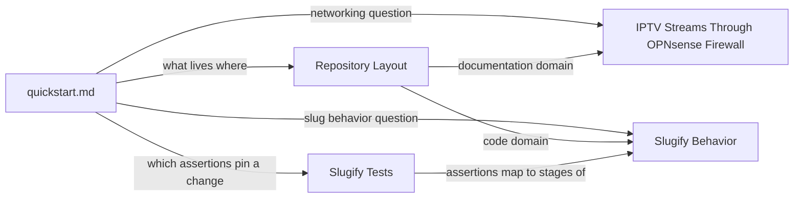

# Quickstart

This repository holds **two completely unrelated concerns side by side**:

1. **The network runbook** — [README.md](../README.md) is the repository's
   primary artifact: a self-contained guide for routing FRITZ!Box 6591 Cable
   IPTV (RTP) streams through an OPNsense firewall. It is documentation, not
   code documentation.
2. **The slug utility** — [slugify.py](../slugify.py) is a stdlib-only Python
   module with one function, `slugify(text) -> str`, pinned by its pytest
   suite in [test_slugify.py](../test_slugify.py).

There is no internal dependency between the two domains; the only internal
edge anywhere is `test_slugify.py` importing `slugify` (see
[Repository Layout](architecture/repository-layout.md)). [AGENTS.md](../AGENTS.md)
makes source code and tests authoritative; the generated `openwiki/` pages are
optional just-in-time context, not required startup reading — see
[What AGENTS.md asks of agents](#expectations-for-agents) below.

## Validate code changes immediately

```bash
pytest test_slugify.py
```

This is the only automated check in the repository and the narrowest quiet
validation that proves a `slugify()` change. The suite imports the helper
directly and needs no installation step beyond pytest (no dependency manifest
exists). Any behavior change in `slugify.py` must update the assertions in
`test_slugify.py` in the same change — the mapping is in
[Slugify Tests](slugify/testing.md).

## Task routing



*How this page routes each concern to the domain pages.*

| Concern | Authoritative file | Read |
| --- | --- | --- |
| FRITZ!Box IPTV through OPNsense (firewall rules, 1:1 NAT, validation) | `README.md` | [IPTV Streams Through OPNsense Firewall](networking/iptv-through-opnsense.md) |
| `slugify(text)` contract: umlauts, NFKD-to-ASCII, hyphen rules, edge cases | `slugify.py` | [Slugify Behavior](slugify/behavior.md) |
| Test groups and which assertions change when behavior changes | `test_slugify.py` | [Slugify Tests](slugify/testing.md) |
| What each top-level file is; absence of build/CI/dependency infrastructure | `LICENSE`, `AGENTS.md` | [Repository Layout](architecture/repository-layout.md) |

## Expectations for agents

- **Do not expect a build system, package manifest, or CI.** The top level is
  flat — `README.md`, `slugify.py`, `test_slugify.py`, `LICENSE`, `AGENTS.md`,
  plus the generated `openwiki/` directory — and `README.md` is the
  deliverable, not a code readme.
- **Keep the domains separate.** Editing the runbook never requires touching
  the slug tests, and changing `slugify.py` never requires touching
  `README.md`; scope edits to one concern.
- **Trust source over wiki.** The runbook and the helper function are the
  sources of truth. Per [AGENTS.md](../AGENTS.md), do not enumerate, preload,
  or search wikis at task start. Pull wiki context only when unfamiliar
  architecture or dependency behavior materially affects the task, when the
  user asks for it, or when source inspection leaves an important uncertainty —
  and stop once the question is grounded. Prefer the narrowest quiet
  validation that proves the changed behavior, and preserve complete failure
  output.
- **Use retrieval tools just-in-time when available.** Where those conditions
  apply, use `openwiki_search` for context and `openwiki_read` for the relevant
  complete sections; if search returns `workspace_required`, ask which listed
  workspace to use and retry with its ID. Only when retrieval tools are
  unavailable should you fall back to reading `openwiki/quickstart.md` and
  follow its links to the relevant pages.
