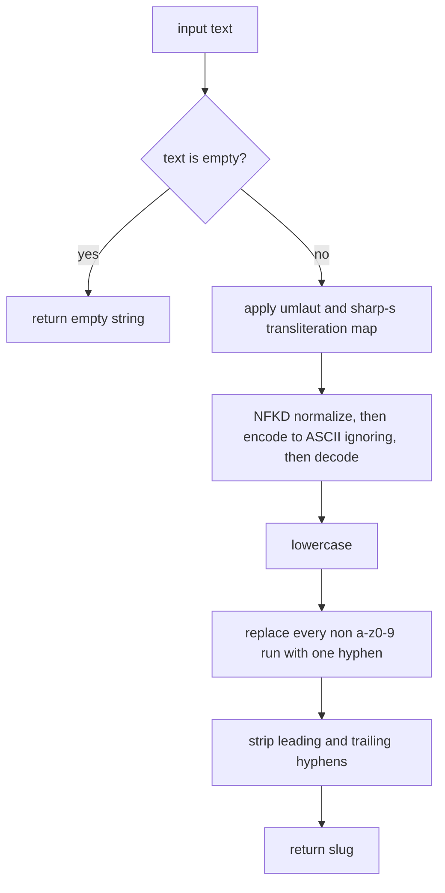

# Slugify Behavior

[slugify.py](../../slugify.py) is a 51-line, standard-library-only module that
exposes exactly **one public function**, `slugify(text: str) -> str`. It
imports only `re` and `unicodedata`, has no module-level state, and touches no
globals, so the helper is a pure text-in/text-out transform that is safe to
copy or inline into another project (under the repository's MIT license). Its
job: turn arbitrary text into a URL-friendly slug — lowercase ASCII letters
and digits joined by single hyphens, with German umlauts and the sharp-s
spelled out German-style.

Nothing in the repository calls `slugify()` except its own test suite,
[test_slugify.py](../../test_slugify.py); the networking runbook in
[README.md](../../README.md) is an unrelated deliverable (see
[Repository Layout](../architecture/repository-layout.md)). That makes the
pytest suite the sole thing pinning this contract, and any behavior change
must update assertions there in the same change.

## The pipeline, in fixed order

*The five transformation stages of `slugify()` in [slugify.py](../../slugify.py);
empty input short-circuits to `""` before any transformation runs.*

The stages run in this exact order, and the order is load-bearing:

| # | Stage | Code | Effect |
| --- | --- | --- | --- |
| 0 | Empty guard | `if not text: return ""` | Empty input never reaches the pipeline. |
| 1 | German transliteration | 7-entry dict applied with sequential `text.replace` calls | `ä→ae`, `ö→oe`, `ü→ue`, `ß→ss`, `Ä→Ae`, `Ö→Oe`, `Ü→Ue` |
| 2 | Unicode → ASCII | `unicodedata.normalize("NFKD", text)` then `text.encode("ascii", "ignore").decode("ascii")` | Decomposes accents; deletes everything without an ASCII decomposition. |
| 3 | Lowercase | `text.lower()` | Folds remaining case so the regex can target `[a-z0-9]` only. |
| 4 | Hyphen collapse | `re.sub(r"[^a-z0-9]+", "-", text)` | Each maximal run of non-slug characters becomes exactly one `-`. |
| 5 | Trim | `text.strip("-")` | Removes leading and trailing hyphens. |

Two ordering details matter for correctness:

- **Transliteration precedes normalization.** The dict is applied by
  iterating `.items()` and calling `text.replace` per entry, in insertion
  order. With the current seven entries there are no cascading interactions
  (no replacement output can be re-matched by a later entry), but that
  property is a consequence of the current map, not of the loop — adding
  overlapping entries would need care.
- **Lowercasing comes after the map and after NFKD.** The uppercase map
  entries expand to *capitalized* forms (`Ä→Ae`, `Ö→Oe`, `Ü→Ue`), and the
  `ß` entry covers both cases (German has no capital ß in this map). Because
  lowercasing happens last of the text stages, `"Über"` and `"über"` both end
  up as `ueber`, and stage 4's regex only ever sees lowercase input — which
  is why its character class is `[a-z0-9]` rather than `[A-Za-z0-9]`.

## Why the explicit transliteration map exists

The map is not a cosmetic extra — it is the only thing standing between
German words and data loss. `unicodedata.normalize("NFKD", …)` followed by
`encode("ascii", "ignore")` keeps *accented Latin* text intact, because
decomposition splits `é` into `e` + combining acute and the ASCII encode then
discards just the combining mark: `café` → `cafe`, `naïve` → `naive`,
`résumé` → `resume` (pinned by `test_unicode_normalization`).

Umlauts and `ß` do **not** survive that path:

- `ß` has no decomposition at all; NFKD leaves it as `ß`, and the ASCII-ignore
  encode deletes it outright. Without the map, `Straße` would degrade to
  `strae` — both a wrong word and a different slug.
- `ä`, `ö`, `ü` decompose to `a`, `o`, `u` plus a combining diaeresis, so the
  ASCII step would silently yield `Muller` for `Müller` instead of the
  expected German transliteration `mueller`.

The explicit map replaces these characters *before* normalization with
multi-letter ASCII spellings, which is why `Müller` → `mueller`,
`Größe` → `groesse`, `Bäckerei` → `baeckerei`, and `Weiß` → `weiss`
(`test_umlaut_transliteration`, `test_sharp_s_transliteration`). If the two
stages were swapped, all of those tests would fail while the accented-Latin
tests would keep passing.

A secondary consequence of choosing **NFKD** (compatibility decomposition)
rather than NFD: presentation forms such as the `fi` ligature or `½` unfold
into plain ASCII (`fi`, `12`) during stage 2 instead of being deleted, so the
ASCII-ignore step only truly discards characters — chiefly non-Latin scripts
like Cyrillic or CJK — that have no ASCII decomposition at all. Such text
vanishes from the output rather than turning into hyphens: only the ASCII
remnant of the input is slugified.

## Edge cases and guarantees

- **Empty input** returns `""` via the stage-0 guard — `slugify("")` is `""`.
- **Whitespace-only input** falls through the pipeline: the spaces collapse
  into a single hyphen at stage 4 and `strip("-")` removes it, so
  `slugify("   ")` is `""`.
- **Special-characters-only input** behaves the same way:
  `slugify("@#$%")` and `slugify("!!!")` are both `""`. Together these three
  cases guarantee the function never returns a bare `"-"` or a
  punctuation-only slug.
- **Digits are slug characters.** The `[^a-z0-9]` class preserves digits and
  hyphenates what surrounds them: `Version 2.0` → `version-2-0` and
  `Item 42` → `item-42`.
- **No boundary hyphens.** Whitespace, punctuation, and hyphens at the start
  or end of the input are absorbed by the collapse-then-trim pair:
  `-Hello-`, `---Hello---`, and `" Hello "` all produce `hello`
  (`test_no_leading_trailing_hyphens`).
- **Run collapsing.** Any number of consecutive separators becomes one
  hyphen — `Hello    World`, `Hello---World`, and `Hello - - World` all give
  `hello-world`.
- **Idempotency.** `slugify()` is a fixed-point operation on its own output:
  `slugify("hello-world")` and `slugify("already-a-slug")` are unchanged
  (`test_already_slugified`). That follows from the pipeline itself — an
  already-slugified string matches no transliteration keys, is unchanged by
  NFKD and lowercasing, has each existing hyphen mapped to itself by the
  `[^a-z0-9]+` substitution, and has no boundary hyphens to strip. Re-slugging
  stored slugs (e.g., when revalidating URLs) is therefore lossless.

## Changing the behavior

The transliteration dict and the pipeline body in
[slugify.py](../../slugify.py) are the only places slug behavior lives — there
is no configuration, registry, or wiring anywhere else in the repository. To
extend the map (say, Danish `ø` or French `œ`), add the entry to the dict and
a matching assertion to the appropriate `TestSlugify` method; see
[Slugify Tests](testing.md) for the assertion-to-behavior mapping and
[Repository Layout](../architecture/repository-layout.md) for how the two
files pair up as the repository's only code and its only automated check.
