# Slugify Tests

[test_slugify.py](../../test_slugify.py) is the repository's only automated
check. It is a single pytest file holding one `TestSlugify` class with twelve
test methods that import the helper directly (`from slugify import slugify`)
and verify it with plain `assert` statements — no fixtures, no marks, no
parametrization, no plugin configuration. Because nothing else in the
repository calls `slugify()` or runs these tests, this suite is the only thing
standing between a behavior change in [slugify.py](../../slugify.py) and a
silent contract regression. The full function contract it verifies is
described in [Slugify Behavior](behavior.md).

```mermaid
flowchart TD
    subgraph STAGES["slugify.py pipeline stages"]
        direction TB
        S0["empty guard"]
        S1["transliteration map"]
        S2["NFKD to ASCII"]
        S3["lowercase"]
        S4["hyphen collapse"]
        S5["trim hyphens"]
    end
    T1["basic ASCII text"] --> S3
    T1 --> S4
    T1 --> S5
    T2["umlaut transliteration"] --> S1
    T2 --> S3
    T3["sharp-s transliteration"] --> S1
    T4["mixed case"] --> S1
    T4 --> S3
    T5["special characters removed"] --> S4
    T6["numbers preserved"] --> S4
    T7["whitespace/hyphen collapsing"] --> S4
    T8["empty + special-only input"] --> S0
    T8 --> S4
    T8 --> S5
    T9["unicode normalization"] --> S2
    T10["no leading/trailing hyphens"] --> S4
    T10 --> S5
    T11["idempotency"] --> S1
    T11 --> S2
    T11 --> S3
    T11 --> S4
    T11 --> S5
```



*Each `TestSlugify` method (or method group) points to the `slugify.py` stages
its assertions actually exercise; a change to any stage must update the test
groups pointing at it.*

## Running the suite

Run from the repository root:

```bash
pytest test_slugify.py      # add -v for per-test output
pytest test_slugify.py -v
```

Three environment facts matter:

- **pytest is imported directly.** `import pytest` sits at the top of
  [test_slugify.py](../../test_slugify.py), so pytest must be installed in the
  interpreter's environment. There is no `requirements.txt`, `pyproject.toml`,
  `setup.py`, `tox.ini`, or `pytest.ini` anywhere in the repo — no version is
  pinned, and pytest is installed ad hoc (e.g. `pip install pytest`).
- **No CI hook exists.** Nothing in the repository runs the suite
  automatically; it executes only when invoked by hand, which is precisely why
  a `slugify.py` change without a paired test update can go unnoticed.
- **No install step is needed.** The import `from slugify import slugify`
  resolves because both files sit in the same directory; run pytest from the
  repository root and discovery works with defaults (no `conftest.py`, no
  custom `rootdir` config).

The file ends with an `if __name__ == "__main__":` guard calling
`pytest.main([__file__, "-v"])`, so it can also be executed directly with
`python test_slugify.py`.

## Test groups, mapped to behavior

The twelve methods are grouped by concern — eleven groups, since empty and
special-characters-only input form one concern across two methods. Each group
pins specific stages of the `slugify()` pipeline
([behavior](behavior.md#the-pipeline-in-fixed-order) documents the stages
themselves).

| Group | Method(s) | Stages pinned | Key assertions |
| --- | --- | --- | --- |
| Basic ASCII | `test_basic_ascii_text` | lowercase, hyphen collapse, trim | `Hello World` → `hello-world`; double spaces and outer whitespace never leak |
| Umlaut transliteration | `test_umlaut_transliteration` | map (lowercase entries, plus `Ü`), lowercase | `Müller`→`mueller`, `Größe`→`groesse`, `Bäckerei`→`baeckerei`, `für`→`fuer`, `Über`→`ueber` |
| Sharp-s (ß) | `test_sharp_s_transliteration` | map (`ß`→`ss`) | `Straße`→`strasse`, `Weiß`→`weiss`, `Maß`→`mass` |
| Mixed case | `test_mixed_case` | uppercase map entries + lowercase | `MÜLLER` == `müller` == `Müller` == `mueller` |
| Special character removal | `test_special_characters_removed` | hyphen collapse | `Hello@World`, `Hello#World`, `Hello$World`, `Hello!World` → `hello-world` |
| Number preservation | `test_numbers_preserved` | `[a-z0-9]` class, hyphen collapse | `Version 2.0` → `version-2-0`; `Item 42` → `item-42` |
| Whitespace/hyphen collapsing | `test_multiple_spaces_collapsed` | hyphen collapse | `Hello    World`, `Hello---World`, `Hello - - World` → `hello-world` |
| Empty & special-only input | `test_empty_string`, `test_only_special_chars` | empty guard, collapse + trim | `""`, `"   "`, `"@#$%"`, `"!!!"` → `""` |
| Unicode normalization | `test_unicode_normalization` | NFKD → ASCII-ignore | `café`→`cafe`, `naïve`→`naive`, `résumé`→`resume` |
| No leading/trailing hyphens | `test_no_leading_trailing_hyphens` | hyphen collapse, trim | `-Hello-`, `---Hello---`, `" Hello "` → `hello` |
| Idempotency | `test_already_slugified` | all stages as fixed points | `hello-world` and `already-a-slug` unchanged |

Every method fails loudly and names the exact `assert` that broke, so a
failing test points straight at the stage whose behavior changed.

### Mixed case: the transliteration map's case-handling pin

`test_mixed_case` is the suite's most load-bearing assertion. It requires
`slugify("MÜLLER")`, `slugify("müller")`, and `slugify("Müller")` to all
return `mueller` — uppercase umlauts must produce the same lowercase output as
their lowercase counterparts. That pins two things at once:

- **The uppercase entries exist in the map** (`Ä`→`Ae`, `Ö`→`Oe`, `Ü`→`Ue`).
  If the `Ü` entry were deleted, `MÜLLER` would survive to the NFKD step,
  decompose to `MULLER`, and slugify to `muller` — a wrong word and a failing
  assert.
- **Case-folding happens after the map.** The uppercase entries expand to
  *capitalized* forms (`Ü`→`Ue`), and only the lowercasing stage folds
  `MUeLLER` into `mueller`. If lowercasing stopped happening, the mixed-case
  assertions would fail.

### Umlaut and sharp-s: coverage of the map's seven entries

`test_umlaut_transliteration` and `test_sharp_s_transliteration` together
exercise the lowercase map entries directly (`ä` in `Müller`/`Bäckerei`, `ö`
in `Größe`, `ü` in `für`, `ß` in `Straße`/`Weiß`/`Maß`) plus one uppercase
entry (`Ü` via `Über` and `MÜLLER`). Note the coverage boundary: **the
uppercase `Ä` and `Ö` entries are never asserted** — no test passes a string
containing `Ä` or `Ö`, so deleting those two map entries would not fail the
suite today. Adding such cases (e.g. `slugify("ÄÖ-Test") == "aeoe-test"`) is
the canonical way to close that gap. The two methods also jointly pin the
map-before-NFKD ordering: if normalization ran first, `Müller` would degrade
to `muller` and these asserts would fail while the accent-only tests below
kept passing.

### Unicode normalization: accented Latin survives the ASCII step

`test_unicode_normalization` pins the behavior of the NFKD/ASCII-ignore stage
for accented Latin text: `café`→`cafe`, `naïve`→`naive`, `résumé`→`resume`.
These inputs contain no umlauts, so this group is the one that keeps passing
even if the transliteration map were reordered or emptied — it verifies the
*normalization* half of the contract independently of the map.
Conversely, it is the group to extend if the normalization step itself
changes (for example, a different Unicode form or a transliteration library
replacing the ASCII-ignore encode).

### Separators, digits, and boundaries

Three groups pin the hyphen-collapse stage from different angles:

- `test_special_characters_removed` shows that punctuation between words
  becomes exactly one hyphen (`Hello@World` → `hello-world`) — removed *and*
  collapsed, not deleted (which would yield `helloworld`) and not doubled.
- `test_numbers_preserved` shows digits survive the `[a-z0-9]` class while
  surrounding separators still become single hyphens (`Version 2.0` →
  `version-2-0`: the space and the period are each their own run, each
  yielding exactly one hyphen).
- `test_multiple_spaces_collapsed` shows any mix of runs — spaces, hyphens,
  or interleaved (`Hello - - World`) — collapses to a single hyphen.

`test_no_leading_trailing_hyphens` then pins the trim stage: separators at the
input boundaries (`-Hello-`, `---Hello---`, `" Hello "`) are absorbed by
collapse plus `strip("-")`, so output never starts or ends with a hyphen.

### Empty, special-only, and idempotent inputs

`test_empty_string` and `test_only_special_chars` are the suite's degenerate
input group: `""`, `"   "`, `"@#$%"`, and `"!!!"` all return `""`. Together
they guarantee `slugify()` never returns a bare `"-"` or a punctuation-only
slug — empty input short-circuits at the guard, while whitespace- and
punctuation-only strings produce a single hyphen that the trim stage then
removes. `test_already_slugified` closes the file with the fixed-point
property: `slugify("hello-world")` and `slugify("already-a-slug")` are
unchanged, so re-slugging stored slugs (e.g. when revalidating URLs) is
lossless. Both methods depend on every pipeline stage being a no-op or fixed
point for slug-shaped input, which is why the diagram points the idempotency
group at all five stages.

## Pairing behavior changes with test updates

Because this suite is the only automated check in the repository — no CI, no
other callers ([Repository Layout](../architecture/repository-layout.md)) — a
change to the transliteration map or the normalization step in
[slugify.py](../../slugify.py) **must be paired with a corresponding test
update here**, or the contract regresses silently. The mapping above makes the
pairing mechanical:

| Change in `slugify.py` | Tests to update or extend |
| --- | --- |
| Add a transliteration entry (e.g. Danish `ø`→`oe`) | extend `test_umlaut_transliteration` (or add a sibling method) |
| Change the `ß` handling | update `test_sharp_s_transliteration` |
| Add/remove uppercase entries | update `test_mixed_case`; consider closing the untested `Ä`/`Ö` gap |
| Change NFKD/ASCII normalization | update `test_unicode_normalization`; re-check `test_empty_string` and `test_only_special_chars` |
| Change lowercasing | update `test_basic_ascii_text` and `test_mixed_case` |
| Change the regex or trim step | update the separator, boundary, empty, and idempotency groups |

New behavior with no existing group (say, length limiting or stopwords)
should get a new test method in the same file rather than assertions bolted
onto unrelated methods — the group-per-concern structure is the map future
readers will follow.

## What the suite does not pin

- The uppercase `Ä` and `Ö` map entries (see above) — deleting them passes
  the current suite.
- Non-Latin script handling: Cyrillic or CJK input vanishes from the output
  ([behavior](behavior.md#why-the-explicit-transliteration-map-exists)
  documents this), but no test asserts it.
- The relative order of lowercasing versus the map is not directly
  observable: for every current input, lowercasing before or after the map
  yields the same result, so only the end-to-end output is pinned, not the
  internal stage order.
- All cases are hand-written asserts; there are no parametrized inputs, so
  adding coverage always means adding assertions in the matching method.
